# Acme School - Plataforma de exámenes en línea

Aplicación web (SPA) para que la escuela Acme gestione usuarios, grupos y exámenes, y para que sus
estudiantes presenten exámenes en línea con un temporizador en tiempo real.

Proyecto del skill **JavaScript** - Campuslands.

## Tecnologías

| Tecnología | Uso |
|---|---|
| HTML5 | Estructura de la página y de cada vista (carpeta `views/`) |
| CSS3 | Variables, Flexbox, Grid, animaciones y diseño responsive |
| JavaScript  | Módulos, clases, campos privados, `fetch`, eventos personalizados |
| Web Components | Custom Elements (`customElements.define`) para cada parte de la interfaz |
| localStorage | Persistencia de los datos en formato JSON |
| JSON | Datos iniciales en la carpeta `data/` |

Sin frameworks ni librerías externas (solo la fuente *Poppins* de Google Fonts).

## Cómo ejecutarlo

El proyecto usa módulos de JavaScript y carga archivos con `fetch`, por lo que necesita un servidor local:

1. Instalar la extensión **Live Server** en VS Code.
2. Clic derecho sobre `index.html` → **Open with Live Server**.

**Cuenta inicial:** `admin@acme.com` / `admin123` (Administrativo).

## Funcionamiento

La aplicación tiene dos partes:

- **Módulos privados (personal):** solo para Administrativos y Docentes, que entran por el **login**
  (vista inicial de la aplicación). El personal no ve la opción de presentar exámenes.
- **Módulo de resolución de exámenes (público):** no requiere iniciar sesión.

### Módulos privados

- **Usuarios:** crear, ver, editar y eliminar usuarios (identificación, nombre, email, teléfono y cargo).
  El personal tiene contraseña; si el cargo es *Estudiante* se le asigna un grupo y no necesita contraseña.
- **Grupos:** crear, editar y eliminar grupos, y cambiar a los estudiantes de grupo.
- **Exámenes:** tabla de exámenes y formulario para crear y editar (código, título, tiempo, porcentaje de
  aprobación, descripción y grupos asignados). Cada examen tiene preguntas con varias respuestas y solo una correcta.
- **Resultados:** historial de exámenes presentados con filtros y estadísticas.

### Módulo de resolución (público)

1. Muestra la lista de exámenes disponibles con su título, tiempo y porcentaje de aprobación.
2. Al elegir uno, el estudiante ingresa su **número de identificación y nombre completo**.
3. La aplicación verifica que sea un estudiante registrado, que el examen esté asignado a su grupo
   y que no lo haya presentado antes (cada examen se presenta **una sola vez**).
4. Responde las preguntas enumeradas mientras corre un reloj en tiempo real.
5. Termina con el botón **Terminar**, o automáticamente cuando el reloj llega a 0.
6. Ve su porcentaje de aciertos y si aprobó o no.

Si se recarga la página durante el examen, continúa donde iba y el tiempo no se reinicia.

## Datos

- La primera vez que se abre, la aplicación carga los archivos JSON de la carpeta `data/`
  (`usuarios.json`, `grupos.json`, `examenes.json`, `resultados.json`).
- Desde ahí todo se guarda en el **localStorage** del navegador, en las claves `acme_*`.
- Para volver a los datos de la carpeta: F12 → *Application* → *Local Storage* → borrar las claves
  `acme_*` y recargar la página.

## Mockups

Wireframes de las pantallas principales. Todas las imágenes están en la carpeta [`img/`](img/).

### Módulos privados (personal)

| Iniciar sesión | Gestión de usuarios |
|---|---|
| 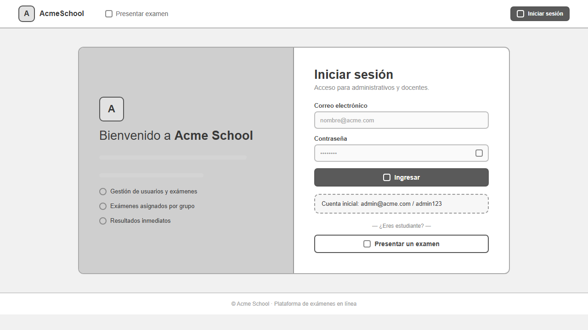 | 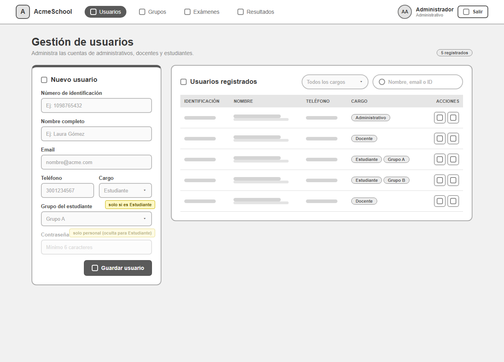 |

| Grupos y estudiantes | Resultados |
|---|---|
| 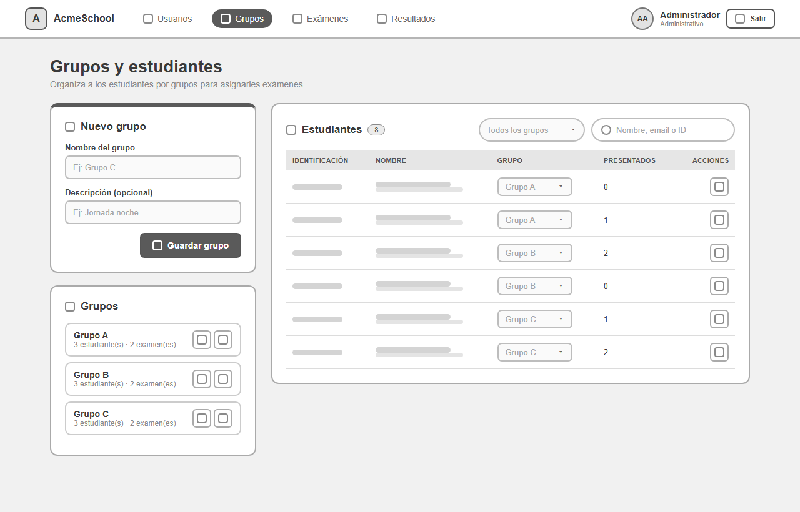 | 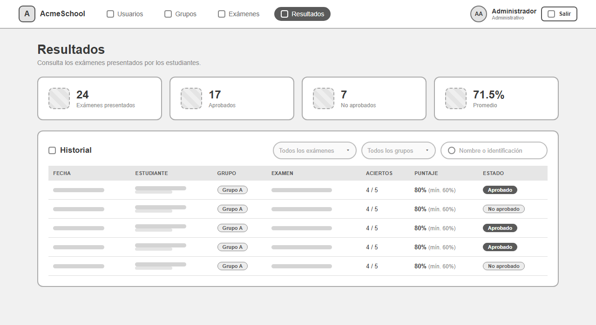 |

**Gestión de exámenes** (formulario con preguntas y grupos asignados, y tabla de exámenes)

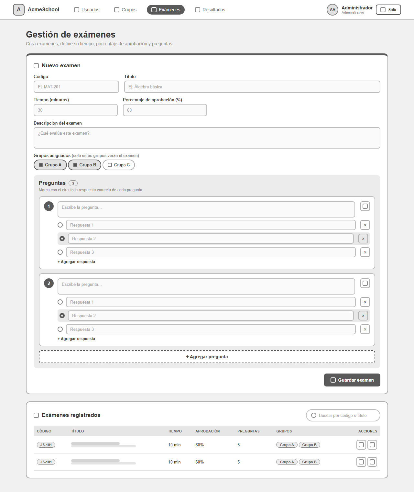

### Módulo de resolución (público)

| Exámenes disponibles | Datos del estudiante |
|---|---|
| 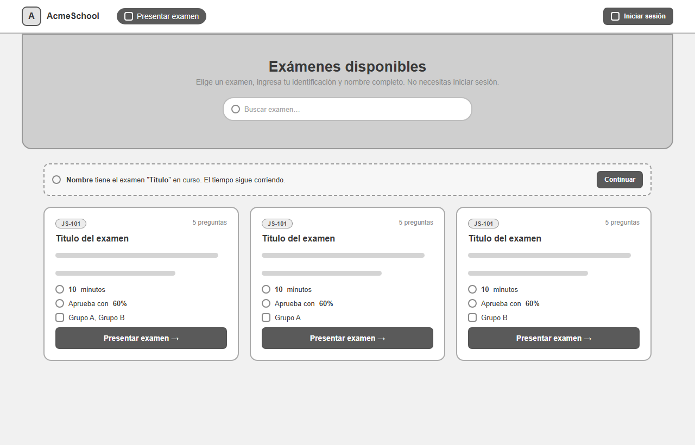 | 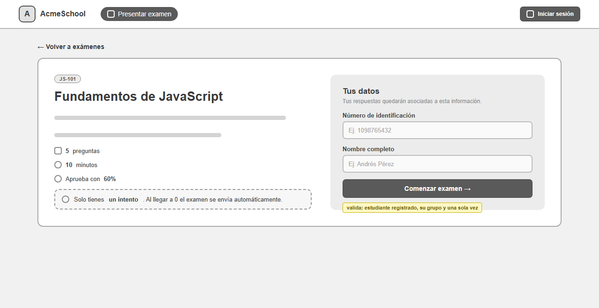 |

| Examen en curso | Resultado |
|---|---|
| 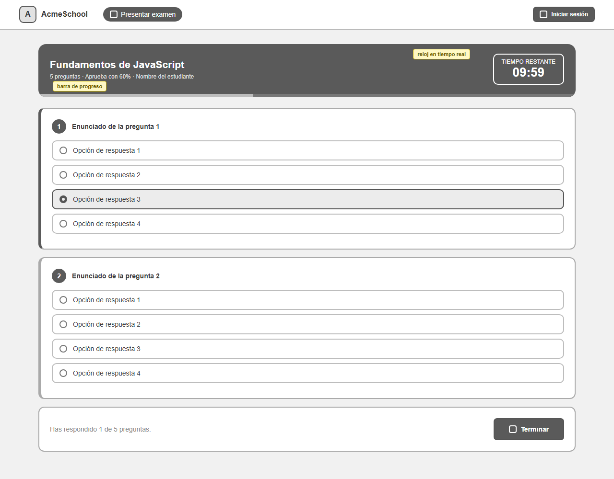 | 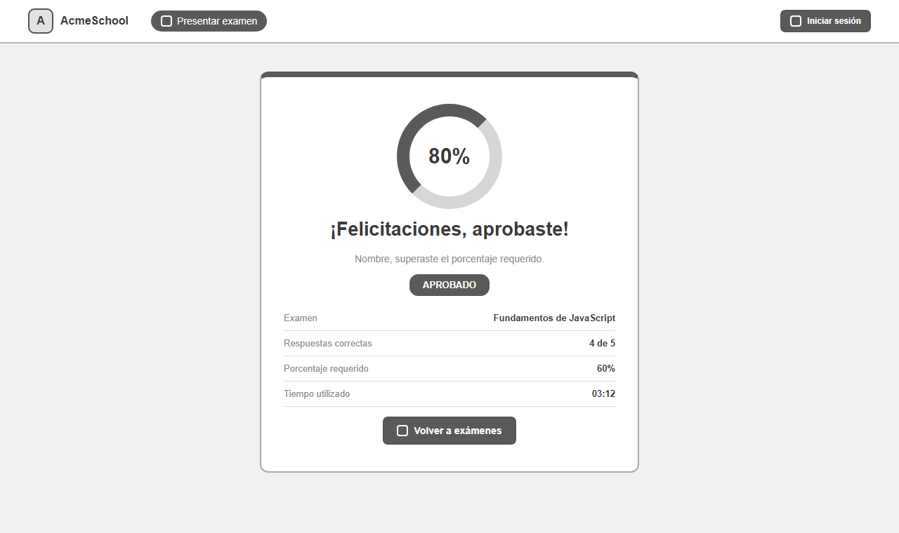 |

### Celular (diseño responsive)

| Iniciar sesión | Usuarios | Examen |
|---|---|---|
| 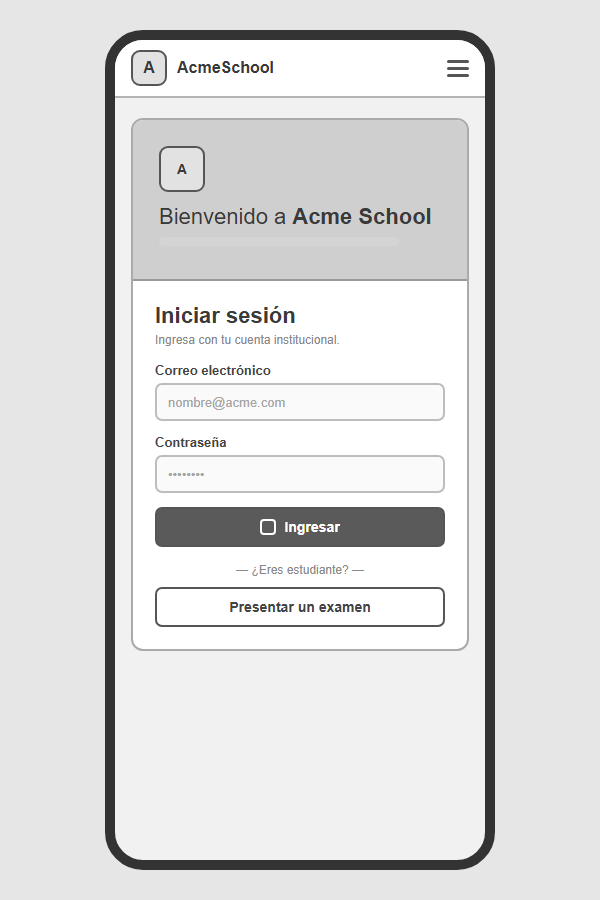 | 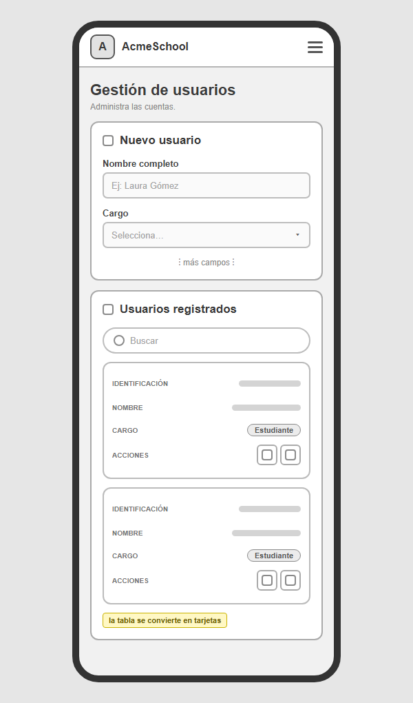 | 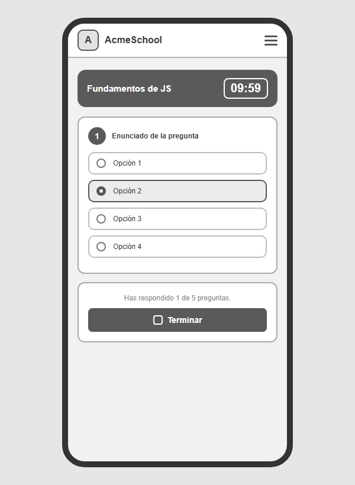 |

## Estructura

```
├── index.html          Página principal (SPA)
├── data/               Datos iniciales en JSON
├── views/              HTML de cada vista (login, usuarios, exámenes, etc.)
├── img/                Mockups (wireframes) de las pantallas
├── css/
│   ├── style.css       Estilos e identidad visual
│   └── animations.css  Animaciones y transiciones
└── js/
    ├── main.js         Arranque y enrutador (navegación por #/ruta)
    ├── storage.js      Lectura y escritura en localStorage
    ├── auth.js         Inicio de sesión del personal
    ├── views.js        Carga de las vistas HTML
    ├── utils.js        Funciones de apoyo (validaciones, avisos, confirmaciones)
    ├── icons.js        Íconos SVG
    └── components/     Web Components (una vista o elemento por archivo)
```

## Autor

**Samid Plata** - Campuslands, skill JavaScript.
